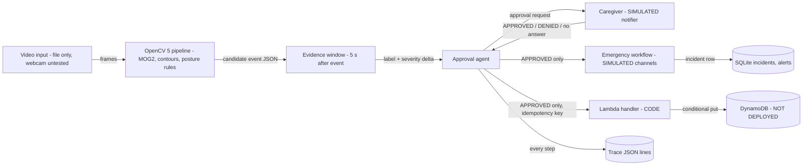

# Architecture

Status key: **[IMPL]** implemented and tested · **[SIM]** implemented, emergency actions simulated · **[CODE]** code tested with a fake/local stand-in, not deployed · **[NOT]** not implemented

## Diagram



## Components

| Component | File | Status | Responsibility |
|---|---|---|---|
| Vision pipeline | `vision/fall_vision.py` | [IMPL] | Background subtraction, largest blob, posture state machine, emits candidate events |
| Clip generator | `vision/synthetic_clips.py` | [IMPL] | Synthetic clips only, for tests and the demo |
| Evidence provider | `vision/evidence.py` | [IMPL] | Runs the pipeline once per clip and serves a time window after an event |
| Approval agent | `agent/approval_agent.py` | [IMPL] | Validates events, runs evidence assessment, requests approval, gates the workflow and store, writes trace |
| Emergency service | `emergency_response_service.py` | [SIM] | Duplicate suppression, incident record, per-channel status; DEMO and INTEGRATION modes |
| Storage (local) | `database_setup.py` | [IMPL] | SQLite incidents, alerts, medications with parameterized SQL |
| Lambda handler | `aws/fall_event_handler.py` | [CODE] | Validates approved events; idempotent conditional write to DynamoDB |
| Local table stand-in | `aws/local_table.py` | [IMPL] | Enforces the same conditional-write rule for tests and demos |
| Alexa MCP server | `alexa_mcp_server/index.js` | [SIM] | Token-protected HTTP API; channels report SIMULATED / NOT_CONFIGURED |
| Legacy accelerometer detector | `bee_detection/fall_detector.py` | [IMPL] | Threshold heuristic on sensor data; not used by the vision path |

## Event schemas

**Candidate vision event** (produced by `VisionFallDetector`):

```json
{"frame_idx": 152, "t_s": 10.133, "rule": "upright->lying within window, centroid dropped, lying held",
 "aspect_before": 2.94, "aspect_after": 0.34, "centroid_drop": 0.27, "hold_s": 1.53}
```
`centroid_drop` is a fraction of standing body height. It is a rule measurement, not a probability.

**Approval request** (agent to caregiver): the candidate event plus `evidence` (one of
`RECOVERED_WITHIN_WINDOW`, `NO_RECOVERY_OBSERVED`, `UNRESOLVED_TRACKING_LOST`) and the adjusted severity.

**Stored approved event** (agent to Lambda):

```json
{"user_id": "7", "event_type": "vision_fall", "timestamp": "2026-10-24T10:00:00+00:00",
 "decision": "APPROVED", "idempotency_key": "a1b2c3d4e5f6"}
```

**Trace step** (JSON lines, one per step, no image data): `VISION_EVENT_RECEIVED`, `REJECTED`,
`EVIDENCE_EXAMINED`, `APPROVAL_REQUESTED`, `DECISION`, `NO_ACTION`, `NO_RESPONSE`, `STORE_RESULT`,
`WORKFLOW_RESULT`.

## Event lifecycle and states

| State | Meaning | Reached by | Next |
|---|---|---|---|
| Candidate fall | The rule fired. Not confirmed. | Vision pipeline | Evidence |
| Evidence examined | Post-event window assessed | Agent | Approval request, with severity adjusted |
| Human confirmation requested | Waiting for a decision | Agent | Approved, denied, or no response |
| Event confirmed | Human approved | Agent, decision APPROVED | Store + workflow |
| Event rejected | Human denied | Agent, decision DENIED | Trace only |
| Unresolved | No decision, or tracking lost | Timeout, or evidence UNRESOLVED | Trace only; manual follow-up |

Missing information is never treated as proof of a fall. Timeouts and unresolved evidence
do not dispatch help automatically.

## Decision policy (deterministic, not an LLM)

1. Reject events that fail validation (`t_s` finite and non-negative, `rule` non-empty, severity 0–10). No request is sent.
2. Examine the 5 s window after the event.
   - Fewer than 5 frames with a visible person: `UNRESOLVED_TRACKING_LOST`, no severity change.
   - Upright posture seen again: `RECOVERED_WITHIN_WINDOW`, no severity change. Still sent to a human.
   - Otherwise: `NO_RECOVERY_OBSERVED`, severity +2 (capped at 10).
3. Request caregiver approval with the evidence label.
4. On APPROVED only: store the event (idempotent), then run the emergency workflow.
5. On DENIED: stop. On no response: stop and log for manual follow-up.

The evidence step uses only the vision pipeline. No language model is involved. Nothing in
this build calls an LLM or generates tool calls from model output.

## Error handling

| Failure | Behaviour |
|---|---|
| Invalid event or severity | Rejected before any request; trace records reasons |
| Video cannot be opened | `IOError` raised to the caller |
| Store (Lambda) fails | Recorded in trace as `error: ...`; emergency workflow still runs for the approved event |
| Duplicate store request | Conditional write refuses; handler returns 200 with `duplicate: true` |
| Emergency channel fails or times out | Channel reported FAILED or TIMEOUT; overall PARTIAL_FAILURE |
| Duplicate incident in window | DUPLICATE_SUPPRESSED; no new actions |

## Security boundaries

- Video is read locally. Only the approved event fields (user id, timestamp, decision, key) leave the machine.
- Alexa MCP server: `/execute_tool` and `/emergencies/:id` require a bearer token; a missing server token fails closed (503).
- Lambda: least-privilege intent is `dynamodb:PutItem` on one table; see `aws/DEPLOY.md`.
- No secrets are stored in source. See `SECURITY_REVIEW.md`.
